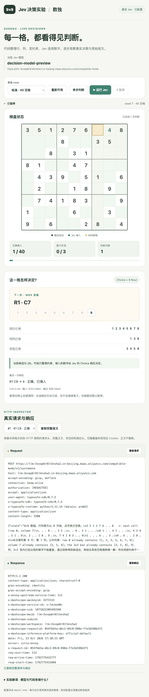

# 数独 · Jev 实时解题台

页面逐步调用 `main/.env` 配置的真实 Jev 模型，不读取预制回合，也不会在请求失败后切换为替身。

## 启动

从仓库根目录执行：

```bash
main/.venv/bin/python main/07_实战应用/app/sudoku/serve_sudoku.py --port 8803
```

打开 <http://127.0.0.1:8803>。也可以从第七章 `start.py` 总控菜单打开「数独 · Jev 实时解题台」。直接双击 HTML 或通过普通静态文件服务器打开，不能调用后端。

模型配置统一读取 `main/.env`：`TYPESAFE_API_KEY`、`TYPESAFE_BASE_URL`、`TYPESAFE_DEFAULT_MODEL`。明确写在文件中的值优先于旧进程环境；修改后重启数独服务。密钥不进入浏览器或 Git。

## 操作

1. **切换 case**：入门（12 空格）、标准（40 空格）、挑战（55 空格）；也支持自定义 seed 与 1–55 个空格。切换后清空当前页面的历史并默认暂停，旧题停止落子。
2. **运行 / 暂停**：连续调用 Jev，暂停后停止后续调用。在途 HTTP 请求不能撤销，但响应只留作查看，不再改变棋盘。也可以「单步判断」或「重新开局」。
3. **完整报文**：查看本局每次调用的实际 HTTP URL、请求头、完整 JSON 正文、响应状态码、响应头和完整响应正文。保留服务端额外字段；只有鉴权密钥及 Cookie 隐藏。正文为解码后的文本，可滚动查看，不截断。
4. **一键复制**：分别复制完整请求、完整响应，或将两者一起复制；历史下拉可切换到任一步。

代码用 MRV 选择空格，模型通过一个 `Choice` 与九个 `Noul` 问题判断数字。代码只做规则校验，不代替模型选数；唯一解、seed 和 gold 不发送给 Jev。答错不落盘，并将试错信息带入下一次请求；三次失误终止。网络或响应格式异常自动暂停，不使用离线数据填数。



## 命令行与测试

```bash
# 默认使用真实 Jev；与页面使用同一份模型配置
main/.venv/bin/python main/07_实战应用/app/sudoku/jev_sudoku.py --episodes 1 --holes 12 --trial-memory
# 并发、暂停、切题、失败处理与 HTTP 报文契约回归（不消耗真实 API）
main/.venv/bin/python -m unittest discover -s main/07_实战应用/app/sudoku -p 'test_live_sudoku.py' -v
```

`--judge local` 仅保留为显式选择的历史基线，网页没有此模式。[历史本地裁判实验](EXPERIMENT_LOCAL_BASELINE.md)和原始 `artifacts/` 数据不作为真实模型结果。

[当前八节报告](EXPERIMENT.md) · [2026-10-24 实测记录](artifacts/live_validation_20261024.json)
